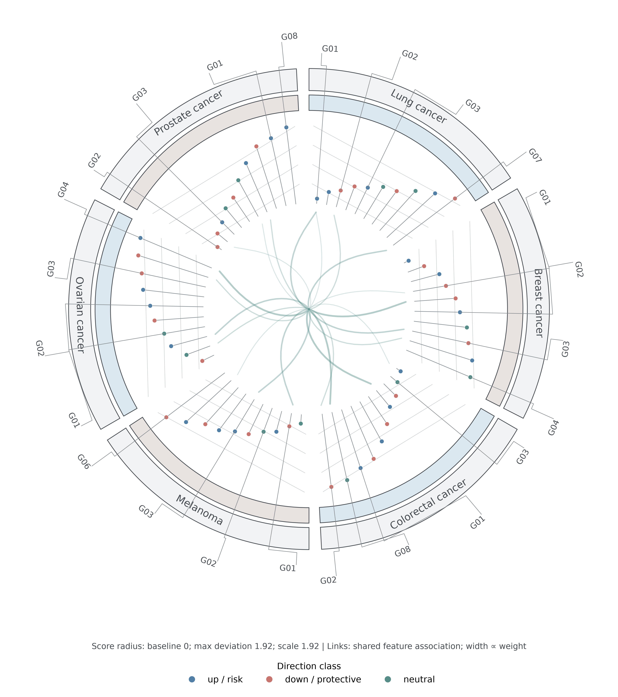

# FigFrame

An integrated SCI scientific-figure skill for biomedical and bioinformatics research.

FigFrame combines four workflows in one skill: evidence-first figure planning, journal-ready export, AI-assisted mechanism schematics, and high-impact visual review. It also includes a tested native Python catalog of 129 plot recipes, including the data-driven `circos_lollipop_chord` composite.

## What it does

- Designs figures from claim, evidence class, analysis unit, and source-data contracts.
- Renders distributions, comparisons, associations, multivariate plots, matrices, networks, survival analyses, genomics, spatial, and mechanism diagrams.
- Exports editable PDF/SVG plus RGB PNG/TIFF with journal-oriented DPI and colour checks.
- Treats AI images as conceptual source assets, never as sole quantitative or causal evidence.
- Audits clipping, typography, colour accessibility, provenance, vector companions, and SHA-256 manifests.

## Quick start

```bash
python skills/figframe/scripts/figure_studio.py catalog
python skills/figframe/scripts/figure_studio.py render --kind volcano_plot --out figure --seed 7
python skills/figframe/scripts/figure_studio.py contact-sheet --out catalog_preview --limit 129
python skills/figframe/scripts/figure_studio.py render --kind circos_lollipop_chord --scores skills/figframe/examples/circos/gene_scores.csv --links skills/figframe/examples/circos/links.csv --sectors skills/figframe/examples/circos/sectors.csv --data-status demo --formats pdf,svg,png --out results/circos
python skills/figframe/scripts/qc_figures.py path/to/figures --output audit/figure_qc.tsv --json audit/figure_qc.json
python skills/figframe/scripts/test_catalog.py --out-dir /tmp/figframe-smoke --limit 129
```

Install runtime dependencies when needed:

```bash
python -m pip install -r skills/figframe/requirements.txt
```

The agent workflow is defined in [`skills/figframe/SKILL.md`](skills/figframe/SKILL.md). The skill trigger is `$figframe`.

The included Circos example tables are synthetic software fixtures, not biological findings. See the [data contract](skills/figframe/references/plot-catalog.md) and [example note](skills/figframe/examples/circos/README.md).


